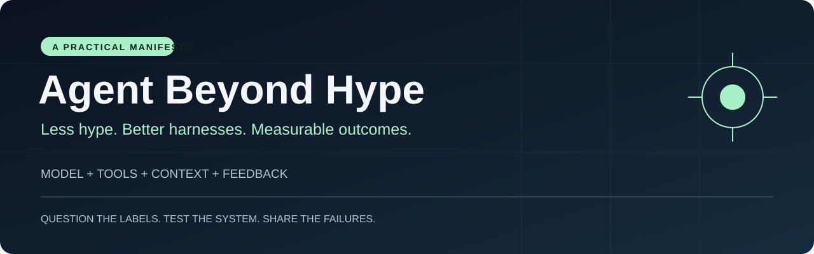
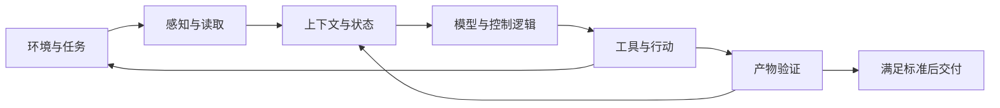

<p align="center"></p>

# Agent Beyond Hype · 别再造概念，先把任务做完

**从「像人一样思考」到「把事情可靠做完」：一个 AI Agent 使用者的思考与实践提案。**

[English](README.en.md) · [完整思考](docs/manifesto.zh-CN.md) · [实践手册](docs/playbook.zh-CN.md) · [任务模板](templates/task-contract.md) · [参与讨论](https://github.com/OolongMint/agent-beyond-hype/issues)

> 我不缺一个听起来更先进的 Agent 概念。
>
> 我缺的是：同一件事，能不能更快、更便宜、更准确地做完。

这个项目从一组个人笔记出发：Agent 像一个配备五官、四肢和大脑的数字工作者；新概念不断出现，但用户真正关心的仍是交付。进一步的问题是：**如果我们一直按照人的工作方式设计 AI，会不会错过机器更擅长的解法？**

这里提供一套可讨论的观点和可复用的 Markdown 模板。项目目前是**思考文章与实践提案**，尚无实测性能数据；欢迎提交反例与实验。

## 30 秒读懂

| 我的主张 | 落到工程上 |
| --- | --- |
| 新名字不自动等于新能力 | 看机制、对照基线、失败案例和维护成本 |
| 好模型只是起点 | 把工具、上下文、执行、验证和恢复一起设计 |
| 上下文要精准 | 按需加载，标注来源与时效，维护可恢复状态 |
| 完成不能靠自我宣告 | 检查产物，用独立标准验收 |
| 省 token 只是局部优化 | 统计失败重试、工具费和人工返工后的总成本 |
| 拟人有助于理解，也可能限制设计 | 用结果比较人类工作流和机器适合的流程 |

## 先用一个模板，把想法变成任务

复制 [任务契约](templates/task-contract.md)，填清楚六件事：

```text
目标：要交付什么？
输入：依据哪些材料？哪份是最新的？
权限：能读什么、改什么、发布什么？
预算：最多花多少钱、多久、重试几次？
验收：谁依据什么证据判断完成？
恢复：中断后如何继续？哪些操作不能重复？
```

然后选一个真实任务，用最简单的方案跑一遍。加入一个 skill、工具或第二个 Agent 后，在相同任务和验收标准下比较。如果没有可观察的收益，就暂时移除它。

完整流程见 [实践手册](docs/playbook.zh-CN.md)；填好的样例见 [发布说明任务](examples/release-notes.md)。

## Agent 的最小理解框架



在本文语境下，**harness 是模型周围让任务跑起来、受约束、能验证、可恢复的运行系统**。Prompt 是其中一部分，skill 是可复用知识与流程，工具提供执行能力。个性化是应用方向；它与 harness 不是同义词。

这是一个便于讨论的框架，不是对所有智能体架构的统一定义。传统智能体也不一定使用 LLM。

## 五个值得争论的问题

1. **Personal Agent 有多少是新能力，有多少是已有能力的重新组合？** 重新组合可以很有价值，但需要说明具体增益。
2. **Harness Engineering 是不是 Prompt Engineering 换名？** 有交集，但执行约束、状态持久化和失败恢复还需要软件系统来实现。
3. **多智能体是不是越多越好？** 只有并行收益、上下文隔离或审查收益超过协调成本时，拆分才有意义。
4. **上下文越长，效果是不是越好？** 可容纳的信息量与能否选对、更新、使用信息，是不同的问题。
5. **AI 必须像人，才能比人更有用吗？** 我倾向于把拟人当作入门比喻，把可验证结果当作设计目标。

论证、边界与反方观点见 [完整思考](docs/manifesto.zh-CN.md)。

## 不只看 token：看每次合格交付的成本

```text
每次合格交付成本 = 全部尝试的总成本 / 验收通过的交付数
总成本 = 模型调用 + 工具与基础设施 + 人工检查与返工
```

失败尝试也计入分子；没有合格交付时，该指标不产生有限有效值。人工时间的折算口径需要提前说明。

同时报告通过率、端到端耗时、人工介入和错误类型。不要用一个漂亮的综合分掩盖不可接受的失败。实验设计见 [对照实验模板](templates/experiment-report.md)。

## 项目导航

| 文件 | 用途 |
| --- | --- |
| [完整思考](docs/manifesto.zh-CN.md) | 从 Agent 类比、概念热潮到超越拟人的设计 |
| [实践手册](docs/playbook.zh-CN.md) | 定义任务、管理上下文、选择工具与验证结果 |
| [任务契约](templates/task-contract.md) | 让一句想法变成可执行、可验收的任务 |
| [交接状态](templates/context-handoff.md) | 给 compact、reset 或跨会话恢复提供明确状态 |
| [验收清单](templates/acceptance-review.md) | 对照证据验收，而非根据语气打分 |
| [实验报告](templates/experiment-report.md) | 比较单 Agent、多 Agent、上下文策略与成本 |
| [填写样例](examples/release-notes.md) | 用发布说明任务演示上述方法 |
| [来源与校准](docs/sources-and-claims.md) | 哪些是资料支持，哪些是观点，哪些仍待验证 |

## 一起把观点变成证据

最欢迎三类贡献：**失败案例、可复现的对照实验、有依据的反驳**。可以用中文或英文提交 [Issue](https://github.com/OolongMint/agent-beyond-hype/issues/new/choose) 或 PR，格式见 [贡献指南](CONTRIBUTING.md)。

如果这里的模板帮你省下了一次返工，可以 Star 收藏，也欢迎分享你删掉了哪些「看起来很先进、实际没必要」的环节。

## 参考与许可

Anthropic 的 [Building effective agents](https://www.anthropic.com/research/building-effective-agents) 区分预设工作流与模型动态控制；[Effective context engineering](https://www.anthropic.com/research/effective-context-engineering-for-ai-agents) 讨论上下文选择。OpenAI 的 [Agent improvement loop](https://developers.openai.com/cookbook/examples/agents_sdk/agent_improvement_loop) 展示如何把运行记录与反馈接入改进过程。本文的实践提案借鉴这些问题意识，不代表厂商认可。

作者：[OolongMint](https://github.com/OolongMint)。基于作者原始想法，经 AI 协助整理、翻译与资料核对。文章和模板按 [CC BY 4.0](LICENSE) 许可共享。初版：2026-10-25。
